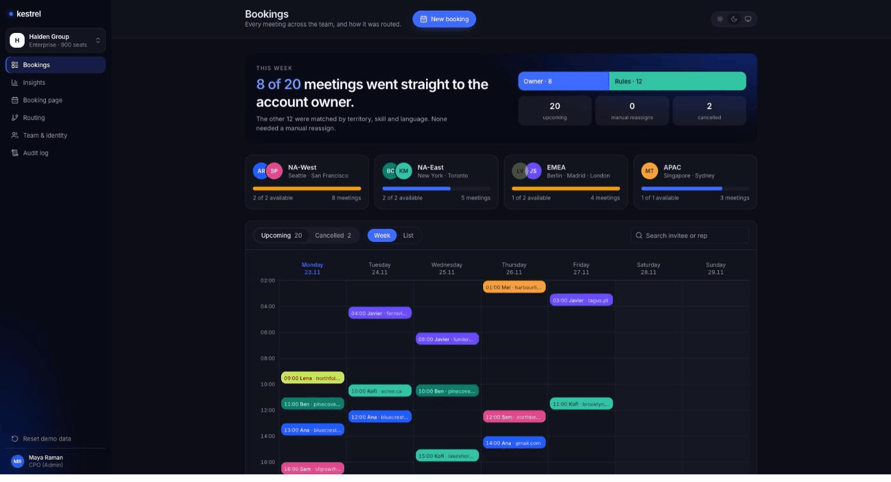

<div align="center">

# Kestrel Smart Routing

**Every booking goes to the right person, the first time, and the product shows you why.**



`React 18` · `TypeScript` · `Vite` · `Tailwind` · `shadcn/ui` · `Node.js` · `Luxon` · `SCIM 2.0`

</div>

---

## The problem

Kestrel's own data pointed somewhere unexpected. The loudest requests (dark mode, Salesforce custom objects) came from Starter accounts and sales prospects. The board goal is **growing accounts with 200+ seats**, and in those accounts the top ask was **routing**: 6 of 13, **$661K ARR**.

The clearest signal came from the largest customer, Halden Group ($182K, 900 seats). It renews on 4 January, its round-robin usage fell **41% in 12 weeks**, and it wrote that it was *"working around it by hand."*

Round robin hands a meeting to whoever is next in line. Existing customers end up meeting strangers, a Seattle lead gets a New York rep at 6am, and ops reassigns meetings by hand.

## What it does

| | |
|---|---|
| **Routes by rules, in order** | Account owner → territory → skill → language. Round robin only breaks ties. |
| **Explains every decision** | Each booking shows *why* that rep, step by step. Customers see a short "finding your person" match; ops sees the full trace in the inspector. |
| **Respects both clocks** | Only offers times inside the customer's day **and** the rep's day. Times are stored in UTC and shown in both zones. |
| **Handles people leaving** | A real `PATCH /scim/v2/Users/:id` from Okta removes the rep from routing and hands their accounts and upcoming meetings to a teammate in the same territory. |
| **Proves it works** | The simulator replays last week's bookings: **right rep 1/8 → 8/8**. Insights tracks the routing mix, demand heatmap and load per rep. |
| **Protects focus time** | Configurable buffers before and after every meeting. The scheduler never offers a slot that would break them, and they show as hatched bands on the week view. |
| **Audit-ready** | Every change is logged by actor and source, and can be exported to CSV for compliance reviews. |

## Tour

| Page | At a glance |
|---|---|
| **Bookings** | "8 of 20 meetings went straight to the account owner." Territory capacity, week grid, list with an inspector panel. |
| **Insights** | Right rep first time went from 25% to 97%, with the routing mix over 8 weeks, a demand heatmap and load per rep. |
| **Booking page** | The customer view: intake → animated match → calendar → confirmation. |
| **Routing** | Rules you can reorder or switch off, a live simulator score, and buffer time (before/after) with a preview. |
| **Team & identity** | Who is in the pool, who is on leave, and Okta/SCIM deprovisioning. |
| **Audit log** | Source breakdown, a 14-day activity chart and a searchable timeline. |

Light, dark and system themes. Demo scenarios are built into the booking page, and **Reset demo data** restores the seed at any time.

## What I prioritised, and what I didn't

The bet is **smart routing**. The other loud asks were weighed against revenue and the board goal:

| Ask | Signal | Decision |
|---|---|---|
| **Smart routing** | 6 of 13 accounts with 200+ seats, $661K ARR; the largest customer is working around it by hand | **The bet.** Built end to end. |
| **Dark mode** | Loudest ask (46 mentions), but all from Starter accounts worth $49K (2% of ARR), none of them churn risks | **Shipped as polish** (Light / Dark / System), not as the sprint's bet: it wouldn't move the 200+ seat goal or protect a renewal. |
| **Buffer time** | 31 accounts asked; the feature already existed, but only 5 had found it | **Rebuilt as a visible setting.** Before/after minutes with a live preview, enforced by the scheduler, shown on the week view, plus a one-click suggestion to turn it on. |
| **Salesforce custom objects** | 19 "Critical" notes, all relayed by sales about prospects; $0 current ARR | **Not built.** Worth a pipeline conversation, not this sprint. |

## Run it

```bash
npm install
npm run build    # builds apps/web into apps/api/public
npm start        # http://localhost:5178
npm run dev      # API + Vite dev server with proxy
```

```
apps/
  web/      React + TypeScript + Vite + Tailwind + shadcn/ui
  api/      Node.js API: routing engine, bookings, SCIM 2.0, audit log
            store.js        storage interface (in-memory today)
            data/seed.json  fixture loaded on boot and on POST /api/reset
packages/
  shared/   TypeScript contracts shared across apps
```

Try SCIM:
```bash
curl -X PATCH -H "Authorization: Bearer demo-okta-token" \
  -d '{"Operations":[{"op":"replace","value":{"active":false}}]}' \
  localhost:5178/scim/v2/Users/ana
```

### Deploy (two Vercel projects)
| Project | Root directory | Preset | Env |
|---|---|---|---|
| API | `apps/api` | Other | — |
| Web | `apps/web` | Vite | `VITE_API_URL=https://<api>.vercel.app` |

## Persistence (deliberate trade-off)
**In-memory by design for a 2-hour prototype. Persistence is behind an interface, and `apps/api/store.js` is the one file you'd change.**

- `apps/api/data/seed.json`: fixture loaded on every boot and on `POST /api/reset`, so the demo always starts from a known state.
- `apps/api/store.js`: the storage interface (`getState`, `listBookings`, `saveBooking`, `updateBooking`, `appendAudit`, `listAudit`, `saveRules`, `updateRep`, `setBuffer`, `nextRoundRobin`, `reset`). Every write in `server.js` goes through it; the routing engine only reads.
- Production: implement the same interface on Postgres (bookings, reps, rules, audit tables) or Redis / Vercel KV, and make `nextRoundRobin` an atomic counter. Routing logic, API and UI don't change.
- On serverless hosts each cold start re-seeds. That's acceptable for a demo, and it's exactly the gap a real store closes.

## Backend notes

What was optimized (zero new dependencies, same endpoints and response shapes):
- **Caching:** the store bumps a `version()` counter on every write. `/api/insights` and `/api/simulate` are memoized on it, and so is the rep-by-id Map index. GET responses carry an ETag and `Cache-Control: no-cache`, so a repeat request gets a 304. Hashed `/assets/*` files are served `immutable` for a year, and `index.html` is `no-cache`.
- **Compression:** JSON, CSV and static responses over 1 KB are compressed with brotli or gzip, based on `Accept-Encoding`.
- **Request hygiene:** bodies are capped at 100 KB (larger ones get 413). Malformed JSON now gets a 400; before, it was silently treated as `{}`. `/api/route` and `/api/bookings` check the email, IANA tz and ISO start. Errors share one `{ error }` shape, unknown `/api` routes return 404, and 500s no longer leak internal messages. Responses carry `nosniff` and `Referrer-Policy` headers. The SCIM token is compared in constant time.
- **Robustness:** the static path is resolved and checked against the public folder prefix, which blocks traversal. SCIM deprovisioning with no active peer to take over now returns 409 instead of crashing. Each request gets an `X-Request-Id` and one structured JSON access-log line with its duration. The server shuts down gracefully on SIGTERM.
- The double-booking check and the save run synchronously with no `await` between them, so they are atomic within a single process.

What I'd do next for real scale:
- Move to Postgres, with indexes on `bookings(rep_id, start)` and a unique constraint on `(rep_id, start)` so the database enforces the double-booking guard. Use a sequence for the round-robin pointer.
- Put a Redis cache in front of the derived data (insights, slot availability), invalidated by version.
- Run stateless API instances horizontally behind a load balancer, all sharing the store.
- Add rate limiting per IP and per SCIM token.
- Send notifications and audit fan-out through a queue (SQS or BullMQ) with retries.
- Add structured logs, metrics and tracing (OpenTelemetry).
